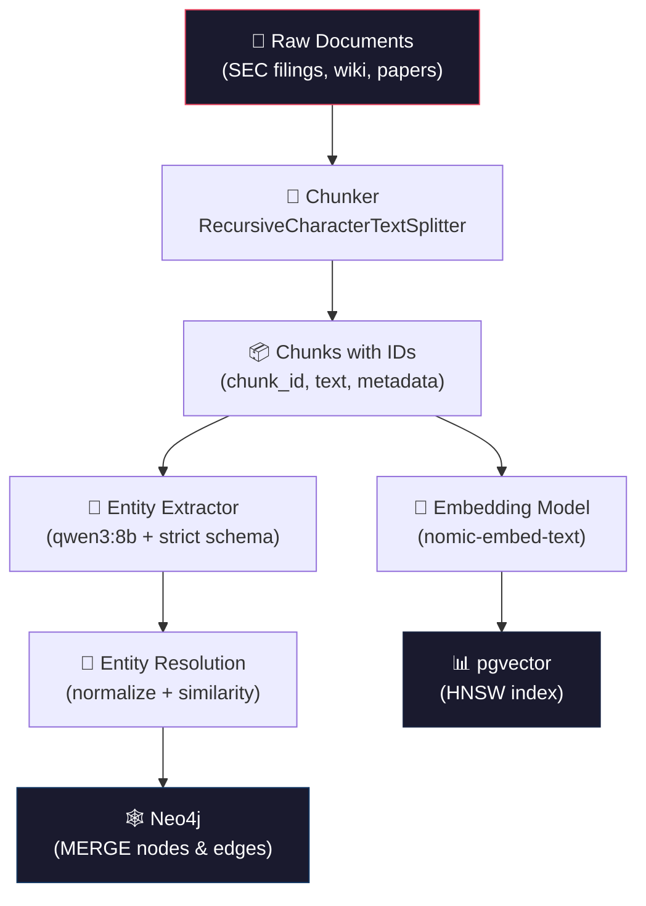
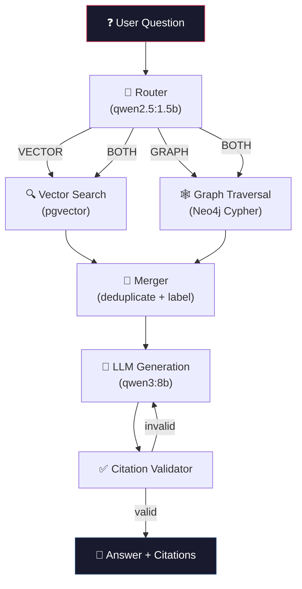

# P1: Knowledge Graph RAG — Complete Theory & Concepts

> **Goal of this document**: Give you end-to-end understanding of *what* we're building, *why* each piece exists, and *how* they fit together — before we write a single line of code.

---

## 1. The Problem Statement (Why This Project Exists)

### 1.1 What is RAG?

**Retrieval-Augmented Generation (RAG)** is a pattern where, instead of asking an LLM to answer purely from its training data, you:

1. **Retrieve** relevant documents/passages from an external knowledge base
2. **Augment** the LLM's prompt with those retrieved passages
3. **Generate** an answer grounded in the retrieved evidence

```
User Question → [Retriever] → relevant passages → [LLM + passages] → Grounded Answer
```

**Why RAG exists**: LLMs have a knowledge cutoff, hallucinate facts, and can't access your private data. RAG solves all three by giving the model evidence to reason over rather than asking it to recall from memory.

### 1.2 Where Plain Vector RAG Falls Apart

The most common RAG approach is **vector search** — embed your documents into vectors, embed the query, find the nearest neighbors. This works well for:

- ✅ "What is our refund policy?" (single fact lookup)
- ✅ "Explain the onboarding process" (definition/procedure)
- ✅ "What does section 4.2 say?" (direct retrieval)

But it **breaks** on questions that require connecting information across multiple documents or entities:

- ❌ "Which companies that Acme Corp invested in also had board members who served at TechCo?"  
  → Requires traversing: Acme → investments → companies → board members → TechCo
- ❌ "Compare the revenue growth of all subsidiaries mentioned in the 2023 filing"  
  → Requires: identifying subsidiaries (entities), finding revenue data for each (aggregation)
- ❌ "What's the relationship chain between Person A and Company Z?"  
  → Requires: multi-hop path traversal

**The core issue**: Vector similarity finds passages that *sound like* the question. But multi-hop questions don't sound like any single passage — the answer is spread across multiple documents connected by *relationships*, not by textual similarity.

### 1.3 What Knowledge Graph RAG Adds

A **Knowledge Graph (KG)** stores information as **entities** (nodes) and **relationships** (edges):

```
[Acme Corp] --invested_in--> [TechStartup Inc]
[TechStartup Inc] --has_board_member--> [Jane Doe]
[Jane Doe] --previously_worked_at--> [TechCo]
```

Now the multi-hop question becomes a **graph traversal** — follow the edges, and you get the answer that vector search could never find.

**Our system combines both**:
- **Vector search** for single-hop factual questions (where it excels)
- **Graph traversal** for multi-hop relationship questions (where vectors fail)
- **A router** that decides which path to take
- **A merger** that combines evidence from both into a grounded, cited answer

This is the **"hybrid"** in "hybrid Knowledge Graph RAG."

---

## 2. Core Concepts — Deep Dive

### 2.1 Knowledge Graphs

#### What is a Knowledge Graph?

A knowledge graph is a structured representation of knowledge as a network of **entities** (things) connected by **relationships** (how things relate).

```
(Entity) --[RELATIONSHIP]--> (Entity)
(Neo4j)  --[IS_A]---------> (Graph Database)
(Neo4j)  --[DEVELOPED_BY]--> (Neo4j Inc.)
```

Each element has **properties** (key-value attributes):

```
Node: {name: "Neo4j", type: "Software", founded: 2007}
Edge: {type: "DEVELOPED_BY", since: 2007, confidence: 0.95}
```

#### Why Knowledge Graphs Matter for RAG

| Capability | Vector DB | Knowledge Graph |
|---|---|---|
| Find similar text | ✅ Excellent | ❌ Not designed for this |
| Multi-hop reasoning | ❌ Impossible | ✅ Native traversal |
| Entity relationships | ❌ Implicit only | ✅ Explicit, queryable |
| Aggregations (count, compare) | ❌ No structure | ✅ Structured queries |
| Contradiction detection | ❌ Hard | ✅ Conflicting edges visible |
| Explainability | ⚠️ "Nearest chunks" | ✅ "Path A→B→C" |

#### The Ontology (Schema of the Graph)

Before extracting anything, you define an **ontology** — a controlled vocabulary of:
- **Entity types**: Person, Company, Product, Document, etc. (5–10 types)
- **Relationship types**: WORKS_AT, INVESTED_IN, SUBSIDIARY_OF, etc. (8–15 types)

> [!IMPORTANT]
> An open-ended "extract all entities" approach produces an unusable graph. The ontology is a *constraint* that makes the graph queryable. This is one of the most common mistakes.

#### Entity Resolution

The same real-world entity can appear in documents with different names:
- "Acme Corp", "Acme Corporation", "ACME", "Acme Corp."

**Entity resolution** collapses these into a single node with an alias list. Without it, your graph has four disconnected nodes for the same company, and traversals break.

Techniques:
1. **String normalization**: lowercase, strip punctuation, expand abbreviations
2. **Embedding similarity**: If two entity names have cosine similarity > threshold, they're candidates
3. **LLM verification**: For ambiguous cases, ask the LLM "Are these the same entity?"

### 2.2 Vector Embeddings & Vector Search

#### What are Embeddings?

An **embedding** is a dense numerical vector (e.g., 768 dimensions) that captures the *semantic meaning* of text. Texts with similar meanings have vectors that are close together in vector space.

```
"refund policy" → [0.12, -0.34, 0.56, ...] (768 dims)
"return guidelines" → [0.11, -0.32, 0.55, ...] ← very close!
"board of directors" → [-0.45, 0.67, 0.12, ...] ← far away
```

#### How Vector Search Works

1. **Indexing**: Chunk documents → embed each chunk → store vectors in a vector database
2. **Querying**: Embed the user's question → find the K nearest vectors → return those chunks

The "nearest" is measured by **cosine similarity** (or L2 distance, inner product).

#### HNSW Index

**Hierarchical Navigable Small World (HNSW)** is the most common approximate nearest-neighbor (ANN) algorithm. It builds a multi-layer graph of vectors where:
- Top layers have few, widely-spaced nodes (for coarse search)
- Bottom layers have all nodes (for fine search)
- Searching starts from the top and drills down

Key parameter: **`ef_search`** — how many candidates to explore. Higher = more accurate but slower.

#### Our Embedding Model: `nomic-embed-text`

Per AGENTS.md, we'll use **`nomic-embed-text`** via Ollama:
- ~0.3GB VRAM (can co-reside with our generation model)
- 768-dimensional vectors
- 8K context window
- Good quality for our scale

### 2.3 Document Chunking

Documents must be split into **chunks** before embedding/extraction. Chunking strategy matters enormously:

| Strategy | How it works | Pros | Cons |
|---|---|---|---|
| Fixed-size | Split every N characters | Simple, predictable | Splits mid-sentence |
| Sentence-based | Split on sentence boundaries | Preserves meaning | Uneven sizes |
| Recursive | Try large splits first, then smaller | Balanced | More complex |
| Semantic | Split where topic changes | Best coherence | Expensive |

**For our project**, we'll use **recursive character splitting** with overlap — it's the best balance of quality and simplicity:
- **Chunk size**: ~1000 characters
- **Overlap**: ~200 characters (so context isn't lost at boundaries)

> [!NOTE]
> The *same chunks* are used for both the vector index and the graph extraction. A chunk's ID is the shared key that bridges both systems — this is the architectural linchpin of the whole project.

### 2.4 The Shared Chunk ID — The Core Architectural Trick

This is the single most important design decision in the project:

```
Document → Chunks (each with a unique chunk_id)
                ↓                          ↓
        Vector Index                 Knowledge Graph
    (chunk_id → vector)        (edges carry source_chunk_id)
                ↓                          ↓
        Retrieved passages         Graph traversal paths
                ↓                          ↓
                └──── chunk_id bridges ────┘
                              ↓
                    Merged, deduplicated context
                              ↓
                        LLM generates answer
                         with citations
```

- From a **graph path**, you can follow `source_chunk_id` back to the original text that justified the relationship
- From a **retrieved passage**, you can look up its `chunk_id` in the graph to find the entity neighborhood around it
- **Citations** are validated by checking that every cited `chunk_id` was actually retrieved

### 2.5 The Query Router

Not every question needs the graph. Not every question works with vectors. The **router** classifies each incoming question:

| Question Type | Route | Why |
|---|---|---|
| "What is X?" | Vector | Definition lookup — vector similarity excels |
| "What's the policy on Y?" | Vector | Single-fact retrieval |
| "How is A related to B?" | Graph | Relationship traversal |
| "Which companies did X invest in that also..." | Graph | Multi-hop |
| "Compare all subsidiaries' revenue" | Graph | Aggregation over entities |
| "Tell me about X and their connections" | Both | Needs facts + relationships |

**Implementation**: A small, fast LLM call (`qwen2.5:1.5b` — only ~1GB VRAM) with a few-shot prompt that returns an enum: `VECTOR`, `GRAPH`, or `BOTH`.

On low confidence → automatically run both paths and merge. This is the **fallback strategy** — it's slower but more robust.

### 2.6 Cypher Query Language

**Cypher** is Neo4j's query language. It uses ASCII art-like syntax:

```cypher
// Find companies that Acme invested in
MATCH (a:Company {name: "Acme Corp"})-[:INVESTED_IN]->(target:Company)
RETURN target.name, target.founded

// Two-hop: Who are board members of companies Acme invested in?
MATCH (a:Company {name: "Acme Corp"})-[:INVESTED_IN]->(c:Company)-[:HAS_BOARD_MEMBER]->(p:Person)
RETURN p.name, c.name

// Three-hop path
MATCH path = (start:Entity {name: $name})-[*1..3]-(end:Entity)
RETURN path
```

> [!CAUTION]
> **Never let the LLM write raw Cypher against your database.** This is both a security hole (injection attacks) and makes results unreproducible. Instead, keep a **template library** keyed by query type and let the LLM fill in *parameters only*.

```python
# Template library approach (safe)
TEMPLATES = {
    "direct_connections": "MATCH (e:Entity {name: $name})-[r]->(t) RETURN t, type(r)",
    "two_hop_path": "MATCH (a {name: $start})-[*2]-(b {name: $end}) RETURN *",
    # ...
}
# LLM only outputs: {"template": "direct_connections", "params": {"name": "Acme Corp"}}
```

---

## 3. The Technology Stack — Why Each Piece

### 3.1 Neo4j (Graph Database)

**What it is**: The most mature, widely-adopted graph database. Stores data as nodes and relationships natively (not as tables with JOINs).

**Why Neo4j and not alternatives?**

| Option | Verdict | Reason |
|---|---|---|
| **Neo4j** | ✅ Our choice | Mature, best Cypher support, huge community, free Community Edition, excellent Docker support |
| NetworkX | ❌ | In-memory only, no persistence, no query language, doesn't scale |
| ArangoDB | ⚠️ | Multi-model but weaker graph-specific tooling |
| Amazon Neptune | ❌ | Cloud-only, violates our "no cloud" constraint |
| TigerGraph | ⚠️ | Powerful but steeper learning curve, smaller community |

**How we'll run it**: Docker container, Community Edition (free), with APOC plugin for advanced procedures.

### 3.2 PostgreSQL + pgvector (Vector Database)

**What it is**: PostgreSQL is the most trusted relational database. **pgvector** is an extension that adds vector storage and similarity search to Postgres.

**Why pgvector and not a dedicated vector DB?**

| Option | Verdict | Reason |
|---|---|---|
| **pgvector** | ✅ Our choice | Runs inside Postgres (we already need it for metadata), HNSW index support, no extra service to manage, production-proven |
| Pinecone | ❌ | Cloud-only |
| Weaviate | ⚠️ | Good but adds another service; pgvector is sufficient for our scale |
| Qdrant | ⚠️ | Same — good standalone, but unnecessary complexity here |
| ChromaDB | ❌ | Toy for prototyping, not production-grade |
| FAISS | ⚠️ | No persistence, in-memory only, no metadata filtering |

**The key insight**: By using pgvector inside Postgres, we get vector search *and* relational metadata (document_id, section_path, date, entity_ids) in one system. This simplifies joins and filtering enormously.

### 3.3 Ollama (Local LLM Inference)

Per AGENTS.md — all inference is local via Ollama. The models we'll use for P1:

| Role | Model | VRAM | Why |
|---|---|---|---|
| **Entity extraction & answer generation** | `qwen3:8b` | ~5.1GB | Best reasoning at our VRAM budget; built-in chain-of-thought |
| **Query routing** | `qwen2.5:1.5b` | ~1GB | Fast, tiny, good at enum/classification tasks |
| **Embeddings** | `nomic-embed-text` | ~0.3GB | Small enough to co-reside with generation model |

**VRAM co-residence**: `qwen3:8b` + `nomic-embed-text` = ~5.4GB ✅ (fits in 8GB)

We'll swap in `qwen2.5:1.5b` for routing (or run it alongside `qwen3:8b` since it's only 1GB).

### 3.4 LangChain (Orchestration Framework)

**What it is**: A framework for building LLM-powered applications. Provides abstractions for chains, retrievers, document loaders, text splitters, etc.

**Why LangChain?**

- **Standardized interfaces**: `BaseRetriever`, `BaseEmbeddings`, `BaseLLM` — lets us swap components
- **Built-in text splitters**: `RecursiveCharacterTextSplitter` with configurable overlap
- **Neo4j integration**: `Neo4jGraph`, `GraphCypherQAChain`
- **pgvector integration**: `PGVector` vectorstore
- **Ollama integration**: Works with Ollama's OpenAI-compatible API out of the box

**What we WON'T use from LangChain**: The high-level "magic" chains that hide logic. We'll use it as a *toolkit*, not as an opaque framework.

### 3.5 FastAPI (API Layer)

**What it is**: A modern, high-performance Python web framework.

**Why FastAPI?**
- Async-native (important for LLM calls that take seconds)
- Automatic OpenAPI docs
- Pydantic validation built-in
- The spec explicitly requires a FastAPI endpoint

---

## 4. The Complete Data Flow — End to End

### 4.1 Ingestion Pipeline (Offline / Batch)



**Step by step**:

1. **Load documents** — PDFs, markdown, text files from a chosen corpus
2. **Chunk** — Split into ~1000-char chunks with 200-char overlap, assigning each a unique `chunk_id`
3. **Embed** — Each chunk → `nomic-embed-text` → 768-dim vector → stored in pgvector with metadata
4. **Extract entities/relationships** — Each chunk → `qwen3:8b` with a strict JSON schema → entities and relationships
5. **Resolve entities** — Normalize names, find duplicates via embedding similarity, merge
6. **Write to Neo4j** — `MERGE` (not `CREATE`) so re-runs are idempotent. Every edge carries `source_chunk_id`

### 4.2 Query Pipeline (Online / Per-Request)



**Step by step**:

1. **Route** — Classify the question as VECTOR, GRAPH, or BOTH
2. **Retrieve** (vector path) — Embed the question → find top-K similar chunks in pgvector
3. **Traverse** (graph path) — Extract entities from the question → resolve to node IDs → run parameterized Cypher template → get paths
4. **Convert** — Graph paths → human-readable statements (not raw triples)
5. **Merge** — Deduplicate results across both paths, label sources ("from graph" / "from vector")
6. **Generate** — LLM produces answer with per-claim citations
7. **Validate** — Check every citation resolves to a chunk_id that was actually retrieved. Reject and regenerate if not.

---

## 5. The Five Build Phases (From the Spec)

### Phase 1: Extract entities and relationships into Neo4j
- Choose a corpus with real relationships (SEC filings, research papers, product docs)
- Define the ontology (5–10 entity types, 8–15 relationship types)
- Run extraction with strict schema validation
- Entity resolution (the hard part)
- Idempotent writes with MERGE

### Phase 2: Build the vector index alongside the graph
- Embed chunks into pgvector with metadata
- Shared chunk_ids between both stores
- HNSW index, tune `ef_search`, measure recall@K

### Phase 3: Route questions to the right retrieval path
- Small model router returning an enum
- Template-based Cypher (never raw LLM Cypher)
- Log every routing decision

### Phase 4: Merge both sources into one grounded answer
- Convert graph paths to readable statements
- Deduplicate, label sources
- Citation validation (reject + regenerate on failure)

### Phase 5: Benchmark against plain vector RAG
- 50–100 question test set, stratified by hop count
- Compare accuracy by: single-hop, two-hop, three-hop, aggregation, out-of-scope
- Report latency and cost per query
- The benchmark table is the portfolio artifact

---

## 6. Key Concepts You Should Be Able to Explain

### 6.1 Why Not Just Use a Bigger Context Window?

"Why not dump all documents into the context window of a model with 128K+ context?"

- **Cost**: Sending 100K tokens per query is expensive (and with local models, slow)
- **Lost in the Middle**: LLMs demonstrably lose information in the middle of long contexts
- **No structure**: The model still can't traverse relationships — it can only do text pattern matching
- **Doesn't scale**: Works for 10 docs, fails for 10,000

### 6.2 Why Not Just Use the Knowledge Graph Alone?

- The graph captures **relationships** but loses the **full text context**. If someone asks "What does the refund policy say?", you need the actual passage, not a triple `(Company)-[HAS_POLICY]->(Refund Policy)`.
- Extraction is **lossy** — you'll never capture 100% of the information as triples
- Vector search handles the "90% of questions" that are simple lookups

### 6.3 What is "Retrieval" vs "Generation" Failure?

This distinction is critical for debugging:

| Failure Type | Symptom | Cause | Fix |
|---|---|---|---|
| **Retrieval failure** | Right answer exists in corpus but wrong chunks are retrieved | Bad chunking, bad embeddings, wrong K | Fix retriever |
| **Generation failure** | Right chunks retrieved but LLM gives wrong answer | Bad prompt, hallucination, reasoning error | Fix prompt/model |
| **Routing failure** | Question sent to wrong retrieval path | Router misclassification | Fix router prompt/examples |
| **Extraction failure** | Entity/relationship missing from graph | Extraction prompt missed it, entity not resolved | Fix extraction pipeline |

### 6.4 MERGE vs CREATE (Idempotent Graph Writes)

```cypher
-- BAD: Creates duplicate nodes on re-run
CREATE (c:Company {name: "Acme Corp"})

-- GOOD: Creates if doesn't exist, matches if it does
MERGE (c:Company {name: "Acme Corp"})
ON CREATE SET c.created = timestamp()
ON MATCH SET c.updated = timestamp()
```

This makes the ingestion pipeline **idempotent** — you can re-run it safely without duplicating data.

### 6.5 What Makes This "Enterprise-Grade"?

The spec calls this "Knowledge Graph RAG for Enterprise Data." What makes it enterprise vs. toy:

| Aspect | Toy Project | Our Project |
|---|---|---|
| Corpus | Random blog posts | Documents with real entity relationships |
| Ontology | "Extract everything" | Constrained, queryable schema |
| Entity resolution | None (duplicates everywhere) | Normalize + similarity + aliases |
| Security | LLM writes raw Cypher | Template library, parameterized queries |
| Citations | "Based on the documents..." | Per-claim, validated chunk_id citations |
| Evaluation | "It seems to work" | Stratified benchmark, hop-count analysis |
| Idempotency | Breaks on re-run | MERGE-based, hash-cached |

---

## 7. Questions We Should Discuss Before Building

Before we move to system design, here are the decisions we need to make:

### 7.1 Corpus Selection
What documents will we use? The spec says they must have real relationships. Options:
- **SEC filings** (companies, people, transactions — rich relationships)
- **Research papers with citations** (authors, papers, citations, institutions)
- **Product documentation with dependencies** (products, features, APIs, versions)
- **Wikipedia subset** (people, organizations, events — easy to get, rich graph)

### 7.2 Ontology Design
What entity types and relationship types will we define? This is domain-specific and depends on our corpus choice.

### 7.3 Evaluation Strategy
How will we build the 50–100 question test set? We need questions stratified by:
- Single-hop (vector should handle these)
- Two-hop (graph advantage starts)
- Three-hop (graph clearly wins)
- Aggregation (graph-only)
- Out-of-scope (system should refuse)

### 7.4 Local Model Limitations
With `qwen3:8b` instead of Claude, we need to be realistic about:
- Entity extraction quality (may need more retries)
- JSON schema adherence (may need validation + retry loops)
- Answer generation quality (may need more careful prompting)

---

## 8. Glossary

| Term | Definition |
|---|---|
| **RAG** | Retrieval-Augmented Generation — retrieve evidence, then generate answers from it |
| **Knowledge Graph** | A structured network of entities (nodes) connected by relationships (edges) |
| **Ontology** | The schema of a knowledge graph: which entity types and relationship types exist |
| **Entity Resolution** | Collapsing multiple mentions of the same real-world entity into one node |
| **Vector Embedding** | A dense numerical representation of text that captures semantic meaning |
| **HNSW** | Hierarchical Navigable Small World — an algorithm for fast approximate nearest-neighbor search |
| **pgvector** | A PostgreSQL extension for storing and querying vector embeddings |
| **Cypher** | Neo4j's graph query language |
| **Chunk** | A segment of a document, small enough to embed and retrieve meaningfully |
| **chunk_id** | The unique identifier that bridges the vector index and the knowledge graph |
| **Router** | A classifier that directs questions to the appropriate retrieval path |
| **MERGE** | Neo4j operation that creates a node/edge only if it doesn't already exist (idempotent) |
| **Recall@K** | The fraction of relevant documents found in the top K results |
| **ef_search** | HNSW parameter controlling accuracy vs. speed tradeoff at query time |
| **Hop count** | The number of relationship traversals needed to answer a question |
| **Idempotent** | An operation that produces the same result regardless of how many times it's executed |

---

> [!TIP]
> **Next step**: Once you've absorbed this, we'll move into **system design** — the actual architecture diagram, API contracts, data models, directory structure, and component-by-component design decisions. That's where we'll brainstorm the "why" behind every specific choice for *our* local setup.
